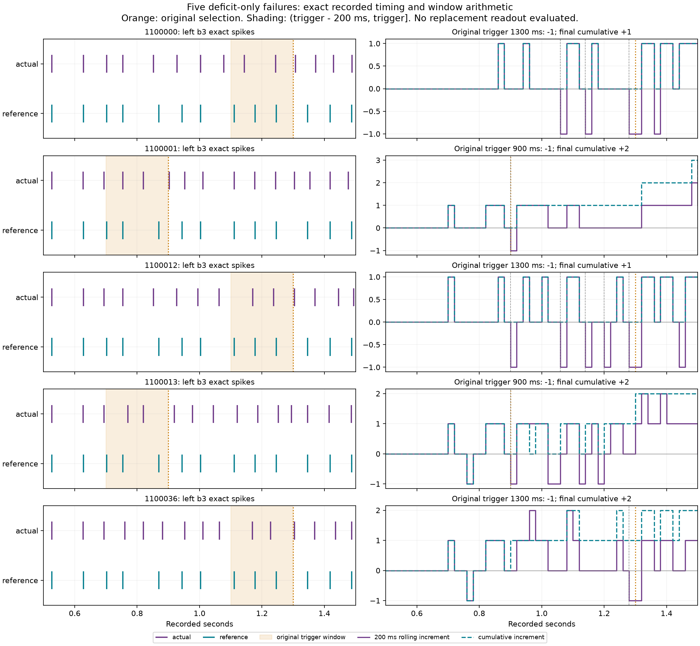
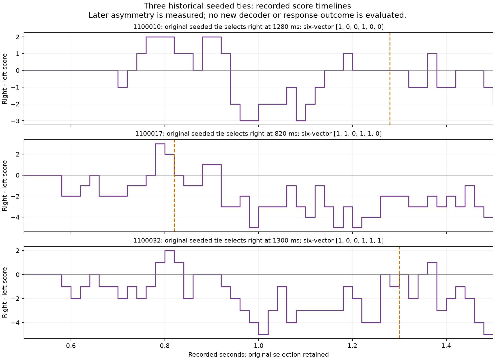

# Escape timing diagnosis complete - 2026-10-07

**The predeclared timing hypothesis is observationally supported.** All eighteen
complete historical cases reproduce their original images, neural counts,
diagnostics, rolling scores, threat events and selected side. All five
deficit-only failures satisfy the four required timing conditions. The neural
model and original readout remain unchanged; escape still has its historical
87/96 failure and remains disabled. No replacement controller was evaluated.

## Measured evidence

Each trigger window contains two actual versus three reference left b3 spikes,
giving -1, while the complete 1.5-second record has a positive cumulative
increment. Exact timing redistribution occurs before the trigger, expiration of
an earlier actual excess produces the temporary deficit, and differential
retained right-DN delivery precedes the first changed b3 spike timing.

| Seed | Original trigger (ms) | Actual b3 spikes in 200 ms window (ms) | Reference b3 spikes (ms) | Differential right-DN delivery /first b3 timing difference (ms) | Last deficit-entry endpoint before trigger (ms) | Final cumulative b3 |
| --- | ---: | --- | --- | --- | ---: | ---: |
| 1100000 | 1300 | 1144,1244 | 1111,1178,1246 | 824 /852 | 1280 | +1 |
| 1100001 | 900 | 754,820 | 702,754,870 | 617 /627 | 900 | +2 |
| 1100012 | 1300 | 1170,1237 | 1111,1178,1246 | 636 /694 | 1280 | +1 |
| 1100013 | 900 | 770,820 | 702,754,870 | 612 /627 | 900 | +2 |
| 1100036 | 1300 | 1169,1228 | 1111,1178,1246 | 563 /627 | 1280 | +2 |

Windows are left-open/right-closed: (1100,1300] or (700,900]. For 1100000,
the actual spike at 1078 ms belongs to the interval ending 1080; that interval
expires at endpoint 1280. The rolling increment becomes -1 and stays there at
the 1300 strong gate. An actual spike at 1307 later changes the count balance.
Some earlier expiration deficits also occur; the complete lists are saved.
Timing redistributes in both directions during the episode, not a uniform
advance of every subsequent spike.

These observations support the predicted timing/window mechanism. They do not
prove that right-DN delivery is necessary, exclude other retained routes, or
establish biological physiology. No ablation or intervention was performed.
The nine successful comparisons differ in elevation/profile as recorded; they
provide historical context rather than controlled interventions.

The three seeded ties (1100010, 1100017, 1100032) reproduce exactly. Their later
left-favoring activity is recorded, but no delayed decoder has been applied.
The mixed unequal failure 1100002 is distinct from the five deficit-only cases;
its repair remains unproven too. All original first selections are retained.





Both saved figures were visually inspected. The first layout's legend obscured
some raster spikes; the final layout moves legends outside the plotted data and
preserves the initial figure. No live interaction review was performed.

## Source preservation, accounting and verification

Frozen configuration remains **589 cells, 4,139 anatomical edges, 3,636 modeled
non-self edges and gains (4,2)**. Original fields, motion rates, float64 neuron
rules, 1 ms steps, 20 ms observations, detector and readout are unchanged. Only
two independent brains ran. Every cell/non-self edge was recorded, including
effective/discarded status, pre/post-reset voltage, phase and complete spikes.

The final detached worker completed exactly five cases/375 intervals,
**7.5 seconds /15,000 individual kernel steps**, with successful terminal
receipt/heartbeat. The aggregate audit selects seven complete cases from the
second run, six from the third and five from the final run. It excludes all
partial prefixes from the support test while preserving/counting their work.

| Record | Actual seconds /individual kernel steps | Complete cases | Note |
| --- | --- | ---: | --- |
| First baseline failure | 0.02 /40 | 0 | Tuple/list comparator defect; consumed |
| Recovery interruption | 11.06 /22,120 | 7 | Includes 560 ms interrupted prefix |
| Progress-publication failure | 10.10 /20,200 | 6 | Includes 1100 ms prefix; next attempted 40 steps never executed |
| Approved final five | 7.50 /15,000 | 5 | Completed normally with append-only journals |
| Aggregate complete episodes | 27.00 /54,000 | 18 | 1,350 complete intervals |
| All executed work | **28.68 /57,360** | 18 | 21 starts, three partial prefixes preserved |

Attempted reservation accounting is 57,400, including the unexecuted 40-step
publication attempt. Engineering verification remains **1,747/2,000**; all
additional recovery/preflight tests and saved audits add zero neural/sensor
steps. No automatic scientific retry, new gain, optimizer, commit or activation.

Observed verification:

```powershell
.venv/Scripts/python.exe artifacts/escape-diagnostic-final-five-2026-10-07/test_guard.py
.venv/Scripts/python.exe artifacts/escape-diagnostic-final-five-2026-10-07/audit_guard.py
```

Preflight: **36 passed**, zero skips, one upstream TorchScript warning (8.59 s),
runtime guard confirms zero neural/sensor calls. Aggregate saved-only audit:
**18 cases, 1,350 intervals, all cell/edge/step equations and original records
exact; supported; zero audit kernel steps**. Historical original audit and
preservation remain verified; final handoff checks bind all current/source
archives and preserved original hashes. Full simulation suite was not run,
as expressly reserved for a subsequently approved neural repair.
Scientific runner commands are consumed records, never rerun instructions.

Evidence: [aggregate audit](../artifacts/escape-diagnostic-final-five-2026-10-07/analysis/audit.json),
[five-condition table](../artifacts/escape-diagnostic-final-five-2026-10-07/five-deficit-evidence.csv),
[1,350 timelines](../artifacts/escape-diagnostic-final-five-2026-10-07/analysis/timelines.csv),
[exact b3 spikes and DN deliveries](../artifacts/escape-diagnostic-final-five-2026-10-07/analysis/events.csv),
[18 case summaries](../artifacts/escape-diagnostic-final-five-2026-10-07/analysis/cases.csv),
[comparison labels](../artifacts/escape-diagnostic-final-five-2026-10-07/pair-labels.csv),
[final receipt](../experiments/escape-diagnostic-final-five-2026-10-07/receipt.json)
and [configuration/source binding](../experiments/escape-diagnostic-final-five-2026-10-07/config.json).

## Decision and learning takeaway

Propose exactly one minimal spike-only temporal readout: cumulative paired
steering counts with a positive winning score, an integer directional margin,
and two consecutive eligible observations. Ties defer for neural evidence.
The algorithm, fixed values, state/reset behavior and gate budgets are in
[the concrete approval proposal](ESCAPE-TEMPORAL-READOUT-PROPOSAL.md).
It is not implemented or scored on these records. No tuning or performance
claim is inferred from the observational support.

PyTorch executes our assumed forward neuron dynamics: 589-element voltage,
phase and spike vectors; 3,636 edge contributions from prior spikes, added to
their directed destinations. Recording and comparing those calculations does
not use autograd or update weights. A local -1 signed count can coexist with
a +1 or +2 full-record increment because the local window forgets an earlier
spike. The diagnosis establishes that arithmetic and temporal association,
not learned behavior or finalized escape.

**One next task / preferred Sol High:** approve the fixed temporal readout
proposal before implementation and its single gated validation experiment.
