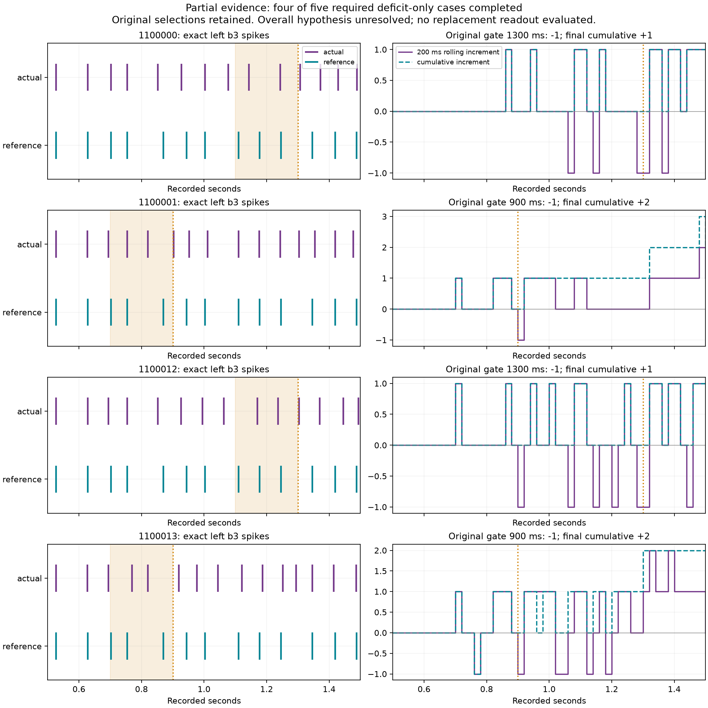

# Remaining diagnostic: Windows journal failure isolated - 2026-10-07

Six more cases completed with all 75 intervals matching history. Combined with
the earlier seven, **13 of 18 complete cases** are available. The detached worker
kept running and its supervisor sealed the failure normally. It stopped during
the next interval reservation with `PermissionError: [WinError 5]`, replacing
`progress.tmp` over `progress.json`. No scientific mismatch was logged.

The failed runner/source archive remains frozen. A new standalone append-only
reservation and heartbeat implementation is tested for the next authorized run;
it has not been used to resume this consumed receipt.

## Verified cause and correction

An ordinary Windows read handle can forbid file replacement while allowing
reads/writes. A controlled reproduction holding `destination.open('rb')` produces
the same WinError 5 on `os.replace`; replacement succeeds after closing the
reader. The actual interfering reader in the experiment is unknown. The writer
assumed delete sharing would always be available; that assumption was incorrect.

The replacement utility holds one persistent append handle. Each reservation is
a finite JSON line followed by flush/fsync **before** a neural call is permitted.
Its in-memory counter commits only after durability succeeds. A failed write
poisons the instance and prohibits another reservation. The budget manifest is
immutable. Heartbeats also append; the terminal heartbeat JSON is created once,
with no replacement. Tests hold real read handles throughout writes, check the
exact budget boundary, reject existing-journal reuse and inject fsync failure to
verify fail-closed behavior. All **30 guarded saved-only tests pass**, zero skips,
one upstream TorchScript warning (6.32 s), zero additional neural/sensory steps.
The four journal-only tests also pass (0.26 s), without warnings.

## Exact computation and evidence

| Quantity | Verified observation |
| --- | --- |
| This run | 6 complete cases +1 partial case through 1100 ms |
| Saved intervals/chunks | 505 full JSON records and 505 complete neural chunks |
| Executed computation | 10.10 simulated seconds /20,200 individual kernel steps |
| Attempted next reservation | Counter 20,240 in `progress.tmp`/receipt; 40 of these never executed |
| Durable counter | `progress.json` remains 20,200 |
| All attempts so far | 21.18 actual simulated seconds /42,360 executed steps; 42,400 attempted reservations |
| Complete aggregate cases | 13 of 18 |
| Timing hypothesis | **Unresolved**: four of five required deficit-only failures meet the conditions; seed 1100036 not presented |
| Escape | Historical 87/96 unchanged; disabled; no new readout or activation |

The exception occurs inside reservation publication, before either kernel call.
The next RGB frame had been computed before the reservation but was not recorded;
it does not represent another executed neural interval. No extra presentation,
scientific retry or resume followed the failure.

The saved-only audit verifies every recorded cell, non-self edge, millisecond,
episode boundary, count, diagnostic and original interval. All 505 records match
history exactly. The first derived audit's metadata accidentally retained 552/553
from the prior audit even though its explicit 505/505 assertion and tables passed.
That artifact is preserved; the corrected final audit uses the actual counters
and is the authoritative result. No raw source/chunk/receipt was altered.

| Deficit-only seed | Trigger (ms) | Actual/reference b3 window spikes (ms) | Differential right-DN delivery /first changed b3 timing (ms) | Final cumulative b3 |
| --- | ---: | --- | --- | ---: |
| 1100000 | 1300 | [1144,1244] /[1111,1178,1246] | 824 /852 | +1 |
| 1100001 | 900 | [754,820] /[702,754,870] | 617 /627 | +2 |
| 1100012 | 1300 | [1170,1237] /[1111,1178,1246] | 636 /694 | +1 |
| 1100013 | 900 | [770,820] /[702,754,870] | 612 /627 | +2 |

Each gate's rolling arithmetic is 2 -3 =-1. Expiration creates the deficit at
1280 ms for the 1300 ms gates and 900 ms for the 900 ms gates. Final cumulative
counts are positive and right-DN delivery precedes timing changes. These four
observations cannot substitute for the predeclared fifth test. Temporal order
also does not establish causal necessity or explain the three seeded ties.

Saved figure visually reviewed; no live interaction review. The initial plotting
lookup selected an earlier not-started placeholder for a later completed seed;
restricting the lookup to completed records fixed that derived figure only.

## Reproducible records and next decision

- [Failed consumed receipt](../experiments/escape-diagnostic-remaining-2026-10-07/receipt.json).
- [Authoritative saved-only audit](../artifacts/escape-diagnostic-remaining-2026-10-07/failure-audit-final.json).
- [505 timeline rows](../artifacts/escape-diagnostic-remaining-2026-10-07/final-partial-timelines.csv)
  and [case status table](../artifacts/escape-diagnostic-remaining-2026-10-07/final-partial-case-status.csv).
- [30-test report](../artifacts/escape-diagnostic-remaining-2026-10-07/journal-guarded-tests.xml)
  and [zero-step guard](../artifacts/escape-diagnostic-remaining-2026-10-07/journal-call-guard.json).
- [Append-only implementation](../src/flybrain/escape_diagnostic_journal.py)
  and [reader/durability tests](../tests/test_escape_diagnostic_journal.py).

Full simulation suite not run, as restricted during diagnosis. No optimizer,
gain search, shadow brain, commit or activation. Engineering remains 1,747.
There is no active scientific worker and the consumed runner must not be rerun.

One next task / preferred Sol High: approve the
[final-five-case proposal](ESCAPE-DIAGNOSTIC-FINAL-FIVE-PROPOSAL.md), with explicit
7.5-second /15,000-step additional budget. It reuses 13 complete records and
repeats only the partial 1100016 start. No neural repair is selected yet.

Learning takeaway: recording can fail independently of neuron arithmetic. A
durable reservation is a prerequisite to a kernel call, not evidence that the
call actually ran. The journal, chunks and source order establish that distinction.
