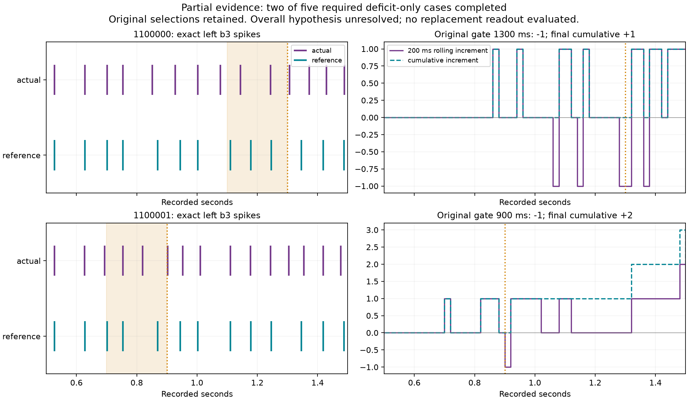

# Comparator recovery: fixed; scientific run interrupted - 2026-10-07

The tuple/list comparison defect is **fixed** in the additive recovery package.
Twenty-one guarded saved-only tests pass. All **552 flushed scientific interval
records** exactly match their historical originals; seven complete cases each
match all 75 intervals. Neuron rules, encoders, gains and readout are unchanged.

The execution process disappeared during the eighth case. The tool later
reported an unknown process session; no Python process remained, no terminal
exception was logged, and the runner's `finally` block did not write a receipt.
The external termination cause is unresolved. This is not a recorded scientific
mismatch. A saved-only finalizer sealed the interruption after verifying that
every reserved interval has a complete neural chunk. Raw chunks, incomplete gzip,
source archives, original parent keys and historical results remain untouched.

| Quantity | Verified observation |
| --- | --- |
| Complete presentations | 7 of 18 |
| Started presentations | 8; eighth stopped at 560 ms |
| Neural chunks / full JSON intervals | 553 /552; final chunk's JSON interval was not flushed |
| New scientific computation | 11.06 simulated seconds /22,120 individual kernel steps |
| Both diagnostic attempts together | 11.08 simulated seconds /22,160 steps |
| Additional engineering steps | 0; cumulative remains 1,747/2,000 |
| Kernel measurement audit | All 589 cells /3,636 non-self edges /every recorded step exact |
| Full hypothesis | **Unresolved**: only two of five required deficit-only failures completed |
| Escape status | Historical 87/96 unchanged; disabled; no new neural repair or activation |

## Measured timing evidence

Both completed deficit-only failures satisfy the four predeclared observational
conditions. The three others were not reached and are not classified by inference.

| Seed | Trigger / window (ms) | Actual b3 spikes in window (ms) | Reference b3 spikes (ms) | First differential right-DN delivery / changed b3 spike (ms) | Final cumulative b3 increment |
| --- | --- | --- | --- | --- | ---: |
| 1100000 | 1300 / (1100,1300] | 1144, 1244 | 1111, 1178, 1246 | 824 /852 | +1 |
| 1100001 | 900 / (700,900] | 754, 820 | 702, 754, 870 | 617 /627 | +2 |

Actual/reference spike timing redistributes before both triggers. Window
expiration creates the -1 increment: seed 1100000 enters the gate's deficit
at endpoint 1280 ms, seed 1100001 at 900 ms. Earlier transient expiration
deficits also occur for 1100000 at 1060 and 1140 ms. At each gate the exact
arithmetic is **2 actual -3 reference =-1**, despite positive final cumulative
counts. Direct right-DN delivery precedes the first changed b3 spike timing.
This is observed temporal order; it does not prove causal necessity or rule out
other retained routes. The mixed unequal and seeded-tie cases are not explained
by these two deficit-only observations.

The figure was visually inspected and contains only complete saved timelines.
No live interaction was reviewed. No replacement decoder was applied to obtain
an improved validation score.

## Verification and files

Saved-only [audit](../artifacts/escape-diagnostic-recovery-2026-10-07/interruption-audit.json)
checks the sealed output hashes, complete tensor recurrence, episode reset and
continuity, counts, diagnostics, windows and exact original interval equality.
Runtime guards record zero simulation/sensor calls. The incomplete last gzip
stream is read as its existing flushed bytes, never repaired or overwritten.
The final 20 ms chunk is fully audited but its absent JSON readout record is
explicitly marked missing.

- [Consumed interruption receipt](../experiments/escape-diagnostic-recovery-2026-10-07/receipt.json)
  and [bound configuration](../experiments/escape-diagnostic-recovery-2026-10-07/config.json).
- [21-test report](../artifacts/escape-diagnostic-recovery-2026-10-07/recovery-tests-final.xml)
  and [zero-step call guard](../artifacts/escape-diagnostic-recovery-2026-10-07/offline-call-guard.json).
- [18 case statuses](../artifacts/escape-diagnostic-recovery-2026-10-07/partial-case-status.csv),
  [553 interval tensor timelines](../artifacts/escape-diagnostic-recovery-2026-10-07/partial-timelines.csv)
  and [two deficit evidence rows](../artifacts/escape-diagnostic-recovery-2026-10-07/partial-deficit-evidence.csv).

Observed commands: guarded tests via
`python artifacts/escape-diagnostic-recovery-2026-10-07/test_guard.py`:
21 passed, zero skips, one upstream TorchScript warning (3.05 s).
Saved audit via
`python artifacts/escape-diagnostic-recovery-2026-10-07/audit_interruption.py`:
passed, zero added kernel steps. Full simulation suite not run as instructed.
The consumed scientific runner must not be rerun. No automatic retry or resume,
shadow brain, extra gain, optimizer update, commit or activation occurred.

A harmless hidden detached-process probe survived the launching tool invocation
and wrote a completion marker, using zero neural/sensory steps. This verifies
normal parent-invocation survival; it does not prove survival of every host-level
termination. Use a detached worker and durable terminal supervision for any
newly authorized long run. The verified comparator does not need another repair.

## Decision and learning takeaway

There is insufficient evidence to choose a neural repair under the required
all-five rule. Preserve this interruption and seek authorization for the
[one remaining-case completion proposal](ESCAPE-DIAGNOSTIC-REMAINING-PROPOSAL.md).
It repeats only the interrupted eighth case and runs the ten never-started cases,
retaining the seven completed records. It explicitly accounts for both partial
starts rather than silently resetting their computation budgets.

A signed rolling spike deficit can result from timing redistribution: one early
actual spike leaves the 200 ms window before a later reference spike, so the
window says -1 while the full record says +1 or +2. PyTorch executes the forward
rules; this count arithmetic and observational diagnosis are not learning.
