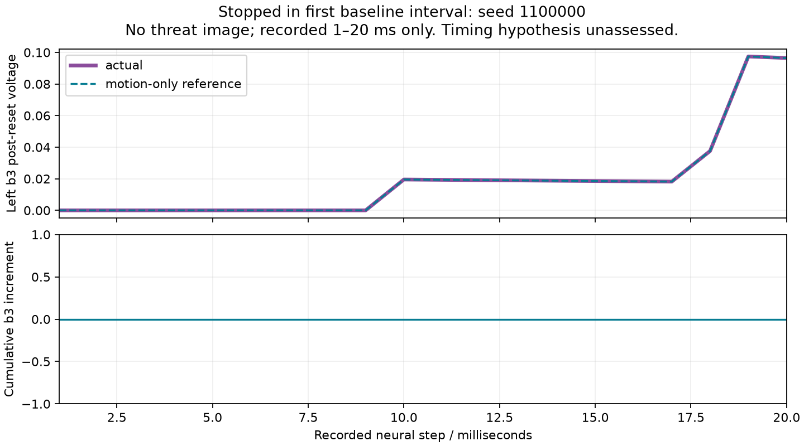

# Escape timing diagnostic — closed incomplete, 2026-10-07

**Hypothesis unresolved.** The one authorized run stopped in seed 1100000's
first 20 ms motion-only baseline interval. A runtime tuple/list comparison
error produced a false historical mismatch in `pathway`. No threat image was
rendered, no trigger occurred, and the four support conditions could not be
assessed in any of the five deficit-only cases. The failed receipt is consumed;
no retry occurred.

The saved serialized interval is **exactly equal** to the historical interval,
including RGB hash, both complete count vectors, original actual diagnostics,
rolling vectors, scores, threat measurement and selection. An independent,
guarded saved-only audit reconstructs all 20 steps for both brains, all 589
cells and all 3,636 non-self edges. It verifies leak, delayed contributions,
threshold/reset, phases, counts and diagnostics with exact equality. This is
baseline evidence only, not evidence for the threat-timing hypothesis.

| Item | Observed result |
| --- | --- |
| Frozen model | 589 cells, 4,139 anatomical edges; 3,636 non-self modeled edges; gains (4,2) |
| Engineering verification | 10 preflight tests passed; final 6 checks passed; 1,747/2,000 individual synthetic kernel steps |
| Scientific execution | 1 started /0 completed presentations; 1 interval; 0.02 simulated seconds; 20 actual +20 reference steps |
| Threat exposure | 0 rendered threat intervals; all recorded RGB is zero baseline |
| Remaining cases | 17 not started; no successful comparison presented |
| Scientific hypothesis | Unresolved; all five deficit-only failures unassessed under threat |
| Escape behavior | Historical 87/96 unchanged; escape disabled; no new readout, closed-loop case or activation |

## Failure and decision

`dataclasses.asdict()` preserves the tuple-valued fields of `DiagnosticInterval`.
Historical JSON loads those same arrays as lists. The runner compared the
runtime dictionary with the loaded JSON dictionary before canonicalizing the
representation. The nine affected fields are current sum/peak, discarded
current, peak voltage/phase, counts, interval/episode first-spike times and
silenced IDs. Numeric values match; container types do not.

The engineering tests checked dataclass parity and NPZ serialization, but missed
the runtime-record versus historical-JSON boundary. The first scientific stop
exposed that gap. The runner correctly sealed failure at its first mismatch;
changing the comparator now would not authorize resuming that receipt.

**One proposed recovery:** correct only this comparison boundary, then seek
authorization for one fresh unchanged-model diagnostic. The exact algorithm,
case order, additional budget and stop rules are in
[the approval proposal](ESCAPE-DIAGNOSTIC-RECOVERY-PROPOSAL.md).
No neural repair algorithm is selected while the requested measurements are
unavailable. The proposal does not claim to address the nine escape failures.

## Evidence, tables and timeline

- [Scientific receipt](../experiments/escape-diagnostic-2026-10-07/receipt.json)
  and [source/configuration binding](../experiments/escape-diagnostic-2026-10-07/config.json).
- [Guarded partial audit](../artifacts/escape-diagnostic-2026-10-07/partial-audit.json)
  verifies the recorded equations and reproduces both raw inequality and
  exact JSON-normalized equality, with zero simulation/sensor calls.
- [18 case execution statuses](../artifacts/escape-diagnostic-2026-10-07/case-execution.csv)
  retain azimuth, elevation/profile and the comparison-minus-failure labels.
- [200 pathway step rows](../artifacts/escape-diagnostic-2026-10-07/baseline-timeline.csv),
  [all 589 cells](../artifacts/escape-diagnostic-2026-10-07/all-cell-baseline.csv),
  [all 3,636 non-self edges](../artifacts/escape-diagnostic-2026-10-07/all-edge-baseline.csv),
  and the [complete compressed chunk](../experiments/escape-diagnostic-2026-10-07/00-1100000/000.npz).



The saved figure was visually reviewed. It ends at 20 ms, shows coincident
actual/reference left b3 voltage and zero cumulative spike increment, and does
not extrapolate toward the absent stimulus. There was no live interaction review.

## Verification and reproduction

Observed commands, from the project root with the venv:

```powershell
.venv/Scripts/python.exe -m flybrain.turnflee.audit experiments/turnflee-2026-10-06
.venv/Scripts/python.exe scripts/audit_turnflee_preservation.py
.venv/Scripts/python.exe -m pytest tests/test_escape_diagnostic.py -q -p no:cacheprovider --junitxml=artifacts/escape-diagnostic-2026-10-07/preflight-tests.xml
.venv/Scripts/python.exe -m pytest tests/test_escape_diagnostic.py -k "not bit_identical" -q -p no:cacheprovider --junitxml=artifacts/escape-diagnostic-2026-10-07/serialization-final.xml
.venv/Scripts/python.exe artifacts/escape-diagnostic-2026-10-07/audit_guard.py
.venv/Scripts/python.exe artifacts/escape-diagnostic-2026-10-07/audit_partial.py
```

The original read-only audit passes 10,800 intervals/3,600 baseline intervals
and its closed 432,000-step budget, adding zero steps. Preservation passes:
all 2,510 originals unchanged; the broader 2,720-file snapshot also passes.
The full simulation suite was **not run**, as expressly reserved for a later
approved repair. One upstream TorchScript deprecation warning occurred per
synthetic test process. No extra threat presentation, shadow brain, gain search,
training, automatic retry, commit or activation occurred. Tests are bounded:
do not rerun the full synthetic file without budgeting its additional calls.

The scientific runner command is a **consumed historical action**, not a rerun
instruction. Saved-only audits can be repeated. The CSV exporter uses fresh-only
outputs; reproduce into an explicitly fresh directory if needed.

## Learning takeaway

PyTorch holds voltage/phase/prior spikes in 589-element tensors and computes
3,636 edge contributions as `weights * previous[pre]`. Each contribution goes
to its directed `post` cell, using spikes from the previous millisecond. These
are our assumed forward neuron rules. Recording the tensors, summing counts and
comparing JSON containers do not invoke autograd or train a brain. Exact numeric
parity can coexist with an incorrect record comparator.

For a concrete saved calculation, left b3 at step 10 has voltage
0.01952983725135624. Step 11 has no incoming contribution, so the original leak
gives `0.01952983725135624 * 0.9900498337491681 = 0.019335512123853555`.
That is below threshold 1, so there is no spike and subtractive reset subtracts
zero. Actual and reference agree exactly. Each edge reads its `pre` neuron and
adds to `post`; in a matrix representation this means `W[post, pre]`, not the
reverse. This forward calculation is separate from gradients/optimizer updates.

**Next task / preferred Sol High:** approve or reject the single comparator-only
recovery and fresh diagnostic proposal. The threat-timing hypothesis remains
unresolved and no neural repair is authorized.
