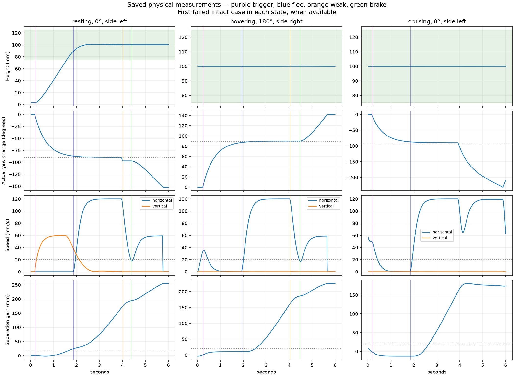

# Frozen candidate physical validation — 2026-10-08

The one authorized physical experiment **failed its original physical gate**:
**19/24 intact successes**, versus ≥22; resting **6/8**, hovering **7/8**,
cruising **6/8**, versus ≥7 in every state. All **24 visual-silent cases have
zero escape triggers**. The new prototype remains **disabled and unlaunched**.
The experiment is sealed/consumed; no tuning, retry or learning followed.

The user's prospective 94/96 directional exception was recorded before this
run. The historical directional experiment still failed at 86.25° (4/6);
1100018 and 1100021 remain known failures. No directional case was rerun and
no readout, gains, sensory encoding, neuron rule or flight policy changed.

Exactly 48 original cases ran in original order/seeds, six seconds each:
**288 simulated seconds /576,000 individual neural steps /14,400 intervals**.
The detached worker exited normally (code 0); its scientific terminal status is
`closed-physical-failed`. All state was finite; max rolling downstream rate
**215 Hz**, below 240. Controller/world named starts were initialized separately;
geometry entered only rendering, environment sensing and evaluation.

| Gate | Recorded outcome | Requirement |
| --- | --- | --- |
| Intact aggregate | 19/24 | ≥22/24 — failed |
| Resting | 6/8 | ≥7/8 — failed |
| Hovering | 7/8 | ≥7/8 — passed |
| Cruising | 6/8 | ≥7/8 — failed |
| Silent escape triggers | 0 in 24 cases | zero — passed |

All 24 intact cases selected an accepted side within 220 ms of first strong
threat, achieved an actual signed 90° turn within 3° before first flee, and
gained at least **159.908 mm** predator-center separation. All eight resting
cases achieved the three-interval 8 mm/contact-false takeoff condition. These
partial successes do not override collision, braking and recovery requirements.
The 0°/180° centerline scoring convention accepts either evasive side.

| Seed | Direction /start | First unmet physical criterion |
| --- | --- | --- |
| 1110000 | 0° /resting | Arena boundary collision at 5.76 s after recovery |
| 1110002 | 0° /cruising | No continuous weak threat, braking or recovery by 6 s |
| 1110012 | 180° /resting | Arena boundary collision at 5.94 s after recovery |
| 1110013 | 180° /hovering | Arena boundary collision at 5.66 s after recovery |
| 1110014 | 180° /cruising | No continuous weak threat, braking or recovery by 6 s |

The three collision records are idle/cruising at X=1.5 or 598.5 mm. Their
altitude/recovery streaks had met the numerical recovery condition earlier;
collision freedom applies to the whole episode. The two cruising failures
remain unrecovered within the prescribed endpoint despite turning/separating.
This is measured behavior, not a completed causal diagnosis of the flight policy.
Silent cases can collide while lacking escape; their gate tests zero escape
triggers, not successful avoidance. No new motion-only baseline is claimed:
the prospective exception binds the previously verified directional evidence.

The [resting](../artifacts/escape-flight-validation-2026-10-08/flight-visuals/flight-resting.png),
[hovering](../artifacts/escape-flight-validation-2026-10-08/flight-visuals/flight-hovering.png)
and [cruising](../artifacts/escape-flight-validation-2026-10-08/flight-visuals/flight-cruising.png)
figures show all paired saved paths. All four flight figures were visually
reviewed separately from a zero-step offscreen viewer preflight. Live review is
pending/unavailable; no activated app or human interaction review is claimed.

The independent saved audit reconstructs temporal decisions from all 589 paired
count vectors, actual physical metrics, CSV/JSON/action coverage, case ordering,
rolling rates, exact reservations, source/circuit/calibration/receipt seals and
gates. It passes and adds **zero neural steps**. Raw CSV vectors use NumPy scalar
repr (`np.float64(...)`), unlike plain JSON numbers. The frozen raw audit rejects
that textual representation. A source-bound additive artifact adapter verifies
each finite vector value by exact float64 hexadecimal representation, then invokes
the original independent numerical auditor on a disposable canonical CSV view.
It edits no source, record, receipt, gate or physical result. Six saved-only
regression tests pass, including numeric changes and unsafe/nonfinite literals.
The original failed audit log is retained. Use the corrected read-only command
below for these sealed records.

Exact saved-action replay **passes all 48 cases /14,400 intervals**, including
visual-silent interventions: every recorded pose, command, sensory-image hash,
count, temporal decision, threat and diagnostic field matches exactly. Replay
uses **576,000 additional individual neural steps** in a separate verification
journal; **zero new scientific cases**. Science remains the single 288 s/576,000-
step experiment. Combined science plus exact replay: 1,152,000 individual steps,
with preflight/test computation separate. No parameters are changed or searched.
[Replay receipt](../artifacts/escape-flight-validation-2026-10-08/replay.json).

Preflight **117 targeted /841 full tests passed**, zero skips; four upstream
warning instances each (60.18/281.86 s). Final suite including the additive
adapter **847 passed**, zero skips, four upstream warning instances (414.03 s),
with fresh logs and isolated diagnostic ledgers. All 4,858
protected original files pass preservation, including consumed proof/experiment
bytes. Original diagnostic engineering proof remains 1,747 steps.

Recorded environment: Python 3.12.10, PyTorch 2.14.0+cpu, NumPy 2.5.3,
Panda3D 1.10.16, Pygame 2.6.1, CPU/single thread. No Git repository/commit;
589 cells, 4,139 anatomical edges, fixed (4,2) gains; optimizer updates zero,
learning rate/checkpoint null. Reproducibility is scoped to this recorded setup.

Evidence: [results](../experiments/escape-flight-validation-2026-10-08/run/results.json),
[receipt](../experiments/escape-flight-validation-2026-10-08/run/receipt.json),
[prospective exception](../artifacts/escape-flight-validation-2026-10-08/prototype-exception.json),
[acceptance denial linking both experiments](../artifacts/escape-flight-validation-2026-10-08/prototype-acceptance.json),
[audit](../artifacts/escape-flight-validation-2026-10-08/audit.json),
[all-case CSV](../artifacts/escape-flight-validation-2026-10-08/physical-cases.csv),
[failure evidence](../artifacts/escape-flight-validation-2026-10-08/analysis.json),
[exact commands/verification](verification/escape-flight-validation.md).

Read-only audit: `./.venv/Scripts/python.exe artifacts/escape-flight-validation-2026-10-08/audit_serialized.py`.
These 48 starts have now been inspected; a later task must treat them as a
historical benchmark, not unseen evaluation. The scientific worker and replay
driver are consumed actions, not rerun instructions.
The new app `python -m flybrain.escape_flight_validation` refuses activation.
Historical launchers/defaults remain unchanged.

Learning takeaway: a correct, timely neural side decision and actual turn can
coexist with unsafe later flight. PyTorch performs the frozen forward spike
calculations; the engineered flight policy governs the subsequent motion.
No autograd, gradient update, optimizer or learning occurred.

One next task /preferred Sol High: diagnose the five saved physical failures and
propose one sensor-only flight-policy repair for boundary-safe recovery and
weak-threat completion, with a new predeclared budget before any experiment.
Keep the accepted readout frozen; do not automatically implement/tune/retry.
