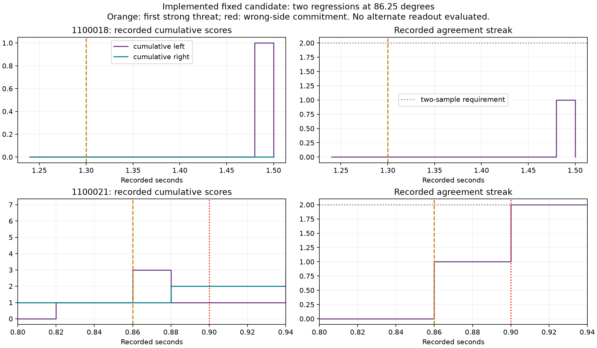

# Implemented temporal recovery - direction gate failed, 2026-10-07

The behavior replacement is implemented and was evaluated once. It scores
**94/96**, improving the same historical benchmark from 87/96 and correcting
all nine old failures. It introduces two failures at **86.25 degrees (4/6)**,
below the required 5/6. The experiment closes at the directional gate.
**Physical escape is not fixed or verified; no closed-loop cases or activation.**

## What actually changed

The additive `escape_recovery` package implements cumulative paired six-cell
spike evidence, a positive winning score and unit margin, two consecutive
eligible observations, a fixed first-strong 500 ms deadline and deferred ties.
It integrates those decisions into the retained turn/flee/brake/recovery policy,
with state reset/rearming, intervention-bound replay, a source-bound candidate,
append-only execution and a receipt-gated new launcher.

The new evaluator records pre-command position/orientation, actual position/yaw,
contact, predator position and commands separately from controller inputs. It
requires actual 90-degree turn within the existing 3-degree tolerance before
flee, resting takeoff, >=2 cm separation, collision freedom, weak braking and
stable cruise recovery. Tests reject passing state labels with absent movement
or a premature flee. These physical criteria were fixed before results; they
have not been evaluated in a formal closed-loop case because direction failed.

Historical sources, all 589 cells/4,139 anatomical edges, frozen (4,2) gains,
sensory encoding, 1 ms neuron rules and old launchers remain unchanged. This is
an engineered readout, not learning; no gradients, optimizer or training.

## Exact remaining failure

Both failures are **new regressions**, not the previous nine failures:

| Seed | Elevation /profile | Measured outcome | Why the fixed rule failed |
| --- | --- | --- | --- |
| 1100018 | -20 /P0 | No response by the 1.50 s endpoint; strong at 1.30 s | Valid left score 1 exists at 1.48 s, but returns to zero at 1.50. The mandatory second sample rejects the brief correct cue. |
| 1100021 | 0 /P1 | Wrong right response at 0.90 s; strong at 0.86 s | At 0.86, cumulative L=3/R=1 starts one left sample. At 0.88, L=1/R=2 changes the streak to right. At 0.90, that wrong preference reaches two samples and commits. |

The evidence does **not** support claiming that temporal agreement guarantees
correctness. Relevant neural evidence can be shorter than two 20 ms samples;
waiting can discard the correct early preference and accept a later wrong one.
This explains the observed regressions under the implemented rule. No alternate
readout was applied to these records and no timing/threshold value was tuned.
For 1100018 the 500 ms deadline extends past the retained recording endpoint;
we report missing response by 1.50 s, not a measured 500 ms timeout.

The saved figure was visually reviewed. It depicts readout evidence, not actual
turning. No live new controller was activated or reviewed.

## Test, source and experiment evidence

Before source locking, the original core implementation passed 25 targeted /
810 full tests. Silent-intervention replay, pre-command yaw anchoring and
premature-flee regression were corrected and then **26 targeted /811 full tests
passed**, zero skips, two/four upstream warnings (11.09/473.04 s).

The first experiment entrypoint omitted a standard-library `math` binding and
failed **before any rendered case or neural step**. The zero-step receipt/source
archive is preserved. An additive corrected entrypoint supplies that dependency
and uses a fresh parent-scoped execution namespace. The readout, neuron rules,
fixed parameter values and scientific budget did not change. The reproduced
entrypoint regression and corrected tests pass: **27 targeted**, zero skips,
two warnings (7.87 s). This was an engineering launch correction, not another
candidate or a repeat of an exposed scientific case.

The corrected experiment completes **96 historical cases /144 simulated seconds
/288,000 individual neural steps /7,200 intervals**. Every unchanged image,
count, original rolling score, threat and neural diagnostic matches the original
model records. The independent saved-count audit reconstructs the cumulative
gate and results, verifies sources/receipts and confirms the failed per-azimuth
gate. It adds zero neural steps. Worker exits normally; record remains consumed.

Existing diagnostic proof stays at 1,747 steps. Old synthetic tests use isolated
temporary ledgers; their new explicit verification totals 529 steps and is saved
separately. No consumed proof was changed. No fallback candidate, extra gain,
scientific retry, closed-loop assay, default change, commit or activation.

Exact current evidence:

- [Scientific results](../experiments/escape-recovery-execution-2026-10-07/run/results.json)
  and [receipt](../experiments/escape-recovery-execution-2026-10-07/run/receipt.json).
- [Independent audit](../artifacts/escape-recovery-execution-2026-10-07/audit.json),
  [historical comparison](../artifacts/escape-recovery-execution-2026-10-07/analysis.json)
  and [failed case table](../artifacts/escape-recovery-execution-2026-10-07/failed-cases.csv).
- [Recorded failure timelines](../artifacts/escape-recovery-execution-2026-10-07/failure-timelines.csv),
  [corrected targeted tests](../artifacts/escape-recovery-execution-2026-10-07/targeted.xml)
  and [pre-lock full tests](../artifacts/escape-recovery-2026-10-07/full-final.xml).

The final whole-suite/source-preservation checks after the entrypoint wiring are
**812 passed**, zero skips, four upstream warnings (240.11 s), with
[current full-suite XML](../artifacts/escape-recovery-execution-2026-10-07/full.xml).
Scientific runner commands are
consumed actions, not rerun instructions. The new gated app remains disabled.

## Why earlier work felt stalled, and what remains

Earlier work diagnosed the original readout and repaired recording failures;
it did not change the active escape controller. This task implemented that
replacement and measured its outcomes. Improvement on the aggregate count is
insufficient: the agreed per-direction gate still fails, so presenting a working
escape app would be an unsupported success claim.

The user selected one candidate with honest closure on a failed gate, rather
than a predefined fallback. That limit is honored. One next task / preferred
Sol High: agree a single spike-event/timing readout that preserves brief correct
cues, with a declared budget before another experiment. Do not automatically
reduce the streak requirement or fit these historical failures.

Learning takeaway: a consistency filter can remove useful transient neural
information. Two matching observations are evidence of persistence, not proof
of the correct steering direction. Controller accuracy must be measured beyond
tests that merely reproduce its chosen algorithm.
