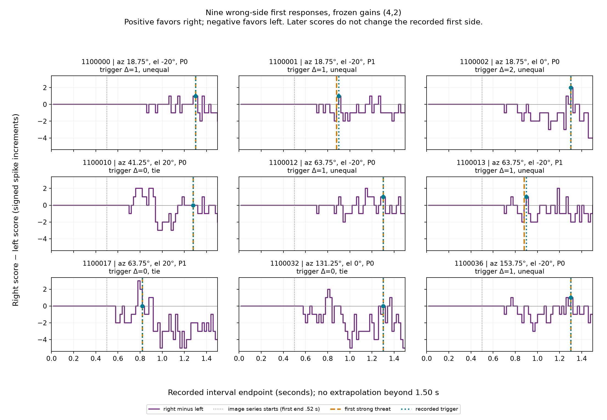

# Frozen wrong-side review — 2026-10-06

The failed **(4,2), 87/96** validation remains closed. All nine failures are
timely right selections against right-side threats: **three exact bilateral
ties and six unequal scores**. Five unequal failures contain only a negative
left b3 increment. Every failure later records a negative right-minus-left
score, but that activity does not change the recorded first selection or
establish improved validation performance. Escape remains disabled.

This review added **zero presentations, zero simulated seconds and zero neural
steps**. It uses saved numerical records and archived source only.

## Reconstruction and nine failures

For each 20 ms endpoint, independently sum the last ten actual-minus-reference
count intervals (200 ms, or the available prefix). In the order
**[i1L, b3L, b1L, i1R, b3R, b1R]**, call this six-vector `v`.

`L = v0 + v1 + v5`, `R = v3 + v4 + v2`, `Δ = R − L`,
`norm = sqrt(sum(v²))`. Thus b1 contributes to the opposite score.
These are engineered unit weights; the scores are signed differences, not
absolute firing rates or measured wing amplitudes.

A strong event renews a 25-tick pending latch. The first eligible endpoint has
norm ≥1 and either unequal scores or nonzero increments on both anatomical
sides. Positive Δ selects right, negative selects left; an exact bilateral tie
uses the first `random.Random(case_seed).choice(('left','right'))`. All 144
first selections and all 10,800 vectors/scores were reconstructed without
calling the production decoder. Ten validation triggers are tied; three fail.

P0 approaches **17→8 cm**, P1 **12→6 cm**. Images begin after the .50 s baseline;
the first image interval ends at .52 s. Onset below means the first **strong
threat event**, not first visible image or first visual spike. All threats below
require left under the frozen ±15° front/rear rule.

| Seed | Azimuth / elevation / profile | Strong / trigger (s) | Latency (ms) | Six-cell v | L / R | Δ | Norm | Tie |
| --- | --- | --- | ---: | --- | --- | ---: | ---: | --- |
| 1100000 | 18.75° / −20° / P0 | 1.30 / 1.30 | 0 | [0,−1,0,0,0,0] | −1 / 0 | +1 | 1 | No |
| 1100001 | 18.75° / −20° / P1 | .88 / .90 | 20 | [0,−1,0,0,0,0] | −1 / 0 | +1 | 1 | No |
| 1100002 | 18.75° / 0° / P0 | 1.30 / 1.30 | 0 | [0,−1,0,1,1,1] | 0 / 2 | +2 | 2 | No |
| 1100010 | 41.25° / +20° / P0 | 1.28 / 1.28 | 0 | [1,0,0,1,0,0] | 1 / 1 | 0 | √2 | Yes |
| 1100012 | 63.75° / −20° / P0 | 1.30 / 1.30 | 0 | [0,−1,0,0,0,0] | −1 / 0 | +1 | 1 | No |
| 1100013 | 63.75° / −20° / P1 | .88 / .90 | 20 | [0,−1,0,0,0,0] | −1 / 0 | +1 | 1 | No |
| 1100017 | 63.75° / +20° / P1 | .82 / .82 | 0 | [1,1,0,1,1,0] | 2 / 2 | 0 | 2 | Yes |
| 1100032 | 131.25° / 0° / P0 | 1.30 / 1.30 | 0 | [1,0,0,1,1,1] | 2 / 2 | 0 | 2 | Yes |
| 1100036 | 153.75° / −20° / P0 | 1.30 / 1.30 | 0 | [0,−1,0,0,0,0] | −1 / 0 | +1 | 1 | No |

**Unequal numerical example, 1100000:** at 1.30 s the ten intervals cover
(1.10,1.30]. Left b3 has **2 actual versus 3 reference spikes**, giving −1;
left i1 and b1 each have 2 versus 2, and all right cells have 0 versus 0.
Consequently L=−1, R=0, Δ=+1 and norm=1. The newly strong event permits a right
selection without a positive right increment. All six counts in the *latest*
20 ms interval are zero; the trigger uses the rolling history. An actual b3
spike at 1.078 s has left the window, whereas a reference spike in the interval
ending 1.12 s remains. Actual spikes in intervals ending 1.16/1.26 s contrast
with reference spikes in intervals ending 1.12/1.18/1.26 s. The exact reference
spike times were not saved. At 1.32 s, actual b3 fires at 1.307 s and Δ becomes
−2. Over the complete 1.5 s record, b3 has **one more** actual spike than
reference; the trigger deficit is local to the rolling window.

**Tied numerical example, 1100010:** at 1.28 s, actual/reference rolling counts
are [3,3,2,1,0,0] versus [2,3,2,0,0,0]. Hence v=[1,0,0,1,0,0],
L=R=1, norm=√2, and both anatomical sides are nonzero. Seed 1100010 chooses
right. Seeds 1100017 and 1100032 also reproduce right exactly at their ties.
These are seeded policy choices, not measured directional information.

## Complete recorded timelines



All cases have 75 intervals ending **.02–1.50 s**. Orange marks first strong
threat; cyan marks the recorded trigger (overlapping when simultaneous). The
purple trace is Δ. No line extends beyond the recorded endpoint.

| Seed | First later Δ<0 (s) | Later endpoints: Δ>0 / =0 / <0 | Final Δ | Time recorded after trigger |
| --- | ---: | --- | ---: | ---: |
| 1100000 | 1.32 | 1 / 1 / 8 | −2 | 200 ms |
| 1100001 | .92 | 2 / 7 / 21 | 0 | 600 ms |
| 1100002 | 1.32 | 0 / 2 / 8 | −4 | 200 ms |
| 1100010 | 1.32 | 1 / 4 / 6 | −2 | 220 ms |
| 1100012 | 1.32 | 1 / 2 / 7 | −1 | 200 ms |
| 1100013 | .92 | 2 / 8 / 20 | 0 | 600 ms |
| 1100017 | .84 | 2 / 0 / 32 | −4 | 680 ms |
| 1100032 | 1.32 | 1 / 1 / 8 | −5 | 200 ms |
| 1100036 | 1.32 | 0 / 3 / 7 | −1 | 200 ms |

The wrong preference is intermittent, rather than persistent through the entire
remaining record. Seven end left-favoring; two end at zero. Earlier negative
scores also occur before the strong gate. The policy retains its first side;
we did not apply a delayed, integrated or replacement decoder. These fixed-body
presentations contain no physical escape trajectory to assess.

## Successful comparisons and calibration

Every failure is compared with **all** successful validation cases at its
azimuth in [comparisons.csv](../artifacts/turnflee-wrong-side-review-2026-10-06/comparisons.csv):
33 same-azimuth comparisons plus nine nearest-calibration comparisons. Full
identities include phase/candidate/azimuth/elevation/profile/seed because seeds
are reused across phases. Every comparison has the same .02–1.50 s recording
window; comparisons do not imply equal exposure after the trigger.

The following exhaustive list gives successful **seed suffix / elevation /
profile / trigger s / Δ** (prefix all suffixes with `11000`). These scores are
the comparison cases' own first-trigger scores. Every one selects left.

| Azimuth | All successful validation comparisons |
| --- | --- |
| 18.75° | 03 / 0° / P1 / .86 / −2; 04 / +20° / P0 / 1.28 / −1; 05 / +20° / P1 / .82 / −1 |
| 41.25° | 06 / −20° / P0 / 1.32 / −1; 07 / −20° / P1 / .88 / −1; 08 / 0° / P0 / 1.30 / −2; 09 / 0° / P1 / .86 / −4; 11 / +20° / P1 / .82 / −1 |
| 63.75° | 14 / 0° / P0 / 1.30 / −2; 15 / 0° / P1 / .86 / −2; 16 / +20° / P0 / 1.28 / −1 |
| 131.25° | 30 / −20° / P0 / 1.32 / −1; 31 / −20° / P1 / .94 / −2; 33 / 0° / P1 / .86 / −2; 34 / +20° / P0 / 1.28 / −1; 35 / +20° / P1 / .82 / −2 |
| 153.75° | 37 / −20° / P1 / .88 / −1; 38 / 0° / P0 / 1.30 / −1; 39 / 0° / P1 / .86 / −1; 40 / +20° / P0 / 1.28 / −1; 41 / +20° / P1 / .82 / −1 |

At 18.75°, both lower-elevation profiles fail; the level long approach also
fails. At 63.75°, both lower profiles fail but the upper short approach is a
tie failure. At 41.25°, only upper P0 fails; at 131.25°, only level P0; at
153.75°, only lower P0. Neither elevation alone nor approach alone explains
all nine. CSV elevation differences are explicitly **comparison minus failure**;
profile changes are flagged, so these observations are not controlled ablations.

Nearest calibration uses circular azimuth distance, **candidate 1 / (4,2)**,
same profile, and **0° elevation in every case**:

| Failure | Calibration seed / azimuth / P | Elevation difference | Calibration L/R; side | Strong / trigger s |
| --- | --- | ---: | --- | --- |
| 1100000 | 1100000 / 0° / P0 | +20° | −1/1; right | 1.30/1.30 |
| 1100001 | 1100001 / 0° / P1 | +20° | 2/2; left, tie | .86/.86 |
| 1100002 | 1100000 / 0° / P0 | 0° | −1/1; right | 1.30/1.30 |
| 1100010 | 1100006 / 45° / P0 | −20° | 3/0; left | 1.30/1.32 |
| 1100012 | 1100006 / 45° / P0 | +20° | 3/0; left | 1.30/1.32 |
| 1100013 | 1100007 / 45° / P1 | +20° | 4/1; left | .86/.86 |
| 1100017 | 1100007 / 45° / P1 | −20° | 4/1; left | .86/.86 |
| 1100032 | 1100018 / 135° / P0 | 0° | 3/1; left | 1.30/1.30 |
| 1100036 | 1100018 / 135° / P0 | +20° | 3/1; left | 1.30/1.30 |

In particular, nearest calibration to 18.75° is **0°, not 45°**. At 0° either
side passes; these two calibration successes do not establish signed lateral
escape. Calibration 16/16 therefore overstates neither validation nor behavior.

## Earliest observable pathway asymmetry and side conventions

All nine failures show right LPLC4 phase activity in the first image interval
ending .52 s and a first right visual spike at **.505 s**; left visual phase and
spikes stay zero throughout. Recorded right visual totals are respectively
**384, 556, 610, 390, 385, 556, 563, 610, 386** in failure-table order.
This is the earliest saved stimulus-associated bilateral asymmetry. It appears
before the first strong event. Actual DN currents already exist during the
motion baseline; their first nonzero time is not evidence of a visual effect.

| Seed | First actual/reference DNp03R count difference (interval end) | First actual DNp03R spike | First DNp26R spike | First left b3 count difference (interval end) |
| --- | ---: | ---: | --- | ---: |
| 1100000 | .84 | .823 | None | .86 |
| 1100001 | .62 | .616 | 1.407 | .70 |
| 1100002 | .56 | .550 | .887 | .70 |
| 1100010 | .62 | .614 | .613 | .70 |
| 1100012 | .64 | .635 | None | .70 |
| 1100013 | .62 | .611 | None | .70 |
| 1100017 | .54 | .534 | .546 | .58 |
| 1100032 | .54 | .536 | .596 | .58 |
| 1100036 | .58 | .562 | None | .70 |

DNp03L has zero actual current, voltage and spikes in all nine. DNp26L has
motion-driven current and subthreshold peaks (maximum .147792), but no spike
or count increment. DNp03R accumulates 8–43 excess spikes; DNp26R 0–23.
These are not simply silent or too-late visual pathways. Four no-spike DNp26R
cases have respective maximum pre-reset voltages .518442, .388424, .777400,
.234187 (seeds 0000, 0012, 0013, 0036). Full bilateral currents/peaks/counts and
timestamps, including baseline intervals, are in
[pathway_cells.csv](../artifacts/turnflee-wrong-side-review-2026-10-06/pathway_cells.csv).

Static retained edges agree with the early opposite-wing increments: DNp03R
directly reaches i1L/b3L (source counts 9/17), DNp26R i1L/b3L (17/8);
left DNs reach the corresponding right endpoints. Right DNs receive 47 and 29
right LPLC4 connections; left DNs receive 40 and 27 left connections. Other
retained routes can influence endpoints too. Summed cell currents cannot assign
a particular spike or voltage change to an individual edge.

Against each nearest calibration, first differences in LPLC4 phase and summed
DN current are already observable at .52 s. First DN count and endpoint-current
differences occur at .52–.56 s, and endpoint-count differences at .52–.60 s.
These are 20 ms interval bounds, not a resolved within-interval causal order.
The comparison CSV records these boundaries for all 42 comparisons.

Archived sources establish the conventions:

- [sensors.py](../experiments/turnflee-2026-10-06/sources/src/flybrain/flight3d/sensors.py): eye 0 spans negative azimuth (left), eye 1 positive (right); columns increase azimuth, rows descend from +80° to −80°. Body axes are right/forward/up; heading zero faces +Y, +yaw turns toward +X/right.
- [experiment.py](../experiments/turnflee-2026-10-06/sources/src/flybrain/turnflee/experiment.py): fixed upright body; stimulus +sin(azimuth) in X, +cos(azimuth) in Y. Thus all nine 0°<azimuth<180° threats lie on body right. The evaluator permits either turn only within 15° of front/rear.
- [anatomy.py](../experiments/turnflee-2026-10-06/sources/src/flybrain/flight3d/anatomy.py) and the hash-bound manifest preserve sourced anatomical side labels and ID ordering; anatomy display coordinates have native anterior −Y and are separate from the flight body's +Y forward frame. Soma positions do not supply receptive fields or steering.
- [encounters3d/neural.py](../experiments/turnflee-2026-10-06/sources/src/flybrain/encounters3d/neural.py): anatomical left/right selects eye 0/1. Within each side, rank assigns row `(rank%6)*4`, column `(rank//6%8)*6`. The frozen manifest has **46 left / 50 right LPLC4 cells**: left lacks ranks 46/47; right ranks 48/49 repeat fields 0/1. This engineered assignment is not measured retinotopy. Those repeated right ranks have no spikes or phase activity in the nine failures, so duplication itself does not explain these cases. Relevant active fields/IDs/totals are in [visual_fields.csv](../artifacts/turnflee-wrong-side-review-2026-10-06/visual_fields.csv).
- [control.py](../experiments/turnflee-2026-10-06/sources/src/flybrain/turnflee/control.py): i1/b3 contribute toward their anatomical score, b1 opposite; Δ>0 commands +90°/right. This source-level chain has no observed global side inversion. Its muscle interpretation is an engineering assumption.

## Conclusions

**Measured:** exact score arithmetic and RNG reproduce all nine recorded wrong
selections. Five failures are exclusively a left b3 rolling deficit; one mixes
that deficit with bilateral increments; three are true bilateral score ties.
Every timeline later becomes left-favoring. All full-record left b3 increments
in the five deficit-only cases are positive (+1,+2,+1,+2,+2). Saved bilateral
visual activity and the cross-side DN-to-wing edges agree with the declared side
conventions. Preservation, receipts and sources pass.

**Supported inference:** the gate can sample a brief reversal in the phase of
tonic actual/reference spikes, rather than a persistent wrong-side response.
The alternating actual-only/reference-only b3 intervals and later reversal
support this in the five deficit-only cases. All modeled effective weights
are positive count shares; a negative local increment does not demonstrate
inhibitory synaptic current. First-gate timing and seeded ties together explain
the selection mechanically. Sparse ID-assigned fields and elevation-dependent
recruitment plausibly alter downstream timing, but their causal contribution
has not been isolated.

**Unresolved:** saved RGB hashes cannot recover raw RGB or patch growth; input
rates and reference voltages/phases/exact spike times are missing. Actual
20 ms peak voltages/summed currents and first spike per interval cannot resolve
all substep events or edge-specific delivery. We cannot identify a unique
receptive-field, edge, reset event or physiological mechanism as the root cause.
No alternative decoder performance, physical escape or unseen generalization
is established. Historical cases remain historical.

## One proposed follow-up — requires separate authorization

**Hypothesis:** in the five deficit-only failures, vision advances the tonic
left b3 spike sequence through the retained right-DN pathway; window expiration
then makes its 200 ms actual-minus-reference count temporarily negative exactly
when the strong gate opens. This hypothesis predicts timing redistribution and
positive cumulative increments, rather than sustained loss of left b3 firing.
It does not claim to explain the three seeded ties or the mixed unequal case.

Propose **unchanged-model instrumentation only**, frozen (4,2), identical
topology, weights, dynamics, inputs, sensory assignment, decoder and seeds.
Use the nine failed validation identities above and these nine distinct
historical successful controls, each once: **1100004, 1100003, 1100005, 1100008,
1100014, 1100015, 1100016, 1100033, 1100037**. Pair them in failure-table order.
All have the same azimuth as their paired failure. Their elevation/profile
differences are respectively **(+40°,same P), (+20°,same P), (+20°,P1 vs P0),
(−20°,same P), (+20°,same P), (+20°,same P), (0°,P0 vs P1),
(0°,P1 vs P0), (0°,P1 vs P0)**. These are context controls, not a clean
elevation/profile intervention. All identities are in the comparison table.

**Hard cap: 18 historical presentations × 1.5 s = 27 simulated seconds /
54,000 paired 1 ms neural steps**, including each .5 s baseline. This is a new
diagnostic proposal, not a continuation of the consumed experiment.

Record raw RGB each 20 ms and its original hash, per-LPLC4 patch salience/growth
and rates/phase, complete actual/reference 1 ms spike times and pre/post-reset
voltages for the four DNs and six endpoints, plus edge-resolved contributions
on all incoming edges to those ten cells and retained intervening paths. Keep
the two brains' numerical update order untouched. Record reference diagnostics
as well as actual; include baseline and exact rolling-window entry/expiry.
Store a new source-bound, clearly instrumentation-only receipt after approval.

Predeclare support only if **each of the five** reproduces its saved trigger
and −1 b3 window, shows prior actual-only/reference-only timing redistribution
and window expiration producing the deficit, retains positive final cumulative
b3 increment, and has time-resolved right-DN delivery preceding the changed
b3 spike timing. Failure of any condition leaves this single hypothesis
unsupported or unresolved; edge delivery establishes an observed temporal
route, not intervention-based causal necessity.

Stop on the first mismatch in original RGB hashes, paired interval counts,
actual saved diagnostics, scores, strong events or first side; on any changed
model/configuration value, nonfinite state, >240 Hz downstream rolling rate,
missing required measurement or budget breach. Otherwise stop after 18 cases.
No extension, gain search, tuning, optimizer, ablation, replacement decoder,
closed-loop evaluation, promotion or retry. A negative result closes the
instrumentation experiment and returns to the user for a new decision.

## Reproduction and verification

From the project root, commands run in this review:

```powershell
.\.venv\Scripts\python.exe -m flybrain.turnflee.audit experiments/turnflee-2026-10-06
.\.venv\Scripts\python.exe scripts/audit_turnflee_preservation.py
.\.venv\Scripts\python.exe scripts/review_turnflee_wrong_side.py
.\.venv\Scripts\python.exe artifacts/turnflee-wrong-side-review-2026-10-06/verify_review.py
```

All pass. The original audit reconciles JSON/CSV, budgets, gates and history;
the independent reviewer reconstructs windows directly from raw paired counts.
[Verification JSON](../artifacts/turnflee-wrong-side-review-2026-10-06/verification.json)
records 10,800 intervals, 42 comparisons/35 unique cases, 2,510 original protected
files and a broader **2,720-file** review snapshot, all unchanged. An additional
runtime call guard permits only audit/anatomy project functions during a fresh
audit; [call evidence](../artifacts/turnflee-wrong-side-review-2026-10-06/audit-call-guard.json)
confirms **zero brain/sensor simulation calls**. The reviewer rejects any
`flybrain` import. New outputs are isolated review artifacts; frozen data,
production code, launchers and defaults remain unchanged.

The guarded offline audit unit test passes **1/1** (including forged-window
rejection); no brain/sensor function runs. `verify_review.py` also checks the
54 contributions, 675 endpoints, 42 comparisons, report links and final hashes.

Machine-readable tables: [cases](../artifacts/turnflee-wrong-side-review-2026-10-06/cases.csv),
[54 cell contributions](../artifacts/turnflee-wrong-side-review-2026-10-06/contributions.csv),
[675 timeline endpoints](../artifacts/turnflee-wrong-side-review-2026-10-06/timelines.csv),
[comparisons](../artifacts/turnflee-wrong-side-review-2026-10-06/comparisons.csv),
[stage summaries](../artifacts/turnflee-wrong-side-review-2026-10-06/stages.csv).
Plot visually inspected. Simulation-targeted and full pytest suites were
**not rerun**: they advance brains/sensors and would violate this review's zero
budget. Historical 188/755 passes remain historical. No live UI check.

Reviewer development initially rejected an incorrect 48/48 visual-cell
assumption; the saved 46/50 manifest corrected it before analysis completion.
The first plot's legend overlapped the axis caption and was corrected/rechecked.
Neither issue changed protected data or invoked simulation.

**Next task / preferred Sol High:** approve, revise or reject this one capped
instrumentation proposal. No experiment has been authorized or run.
